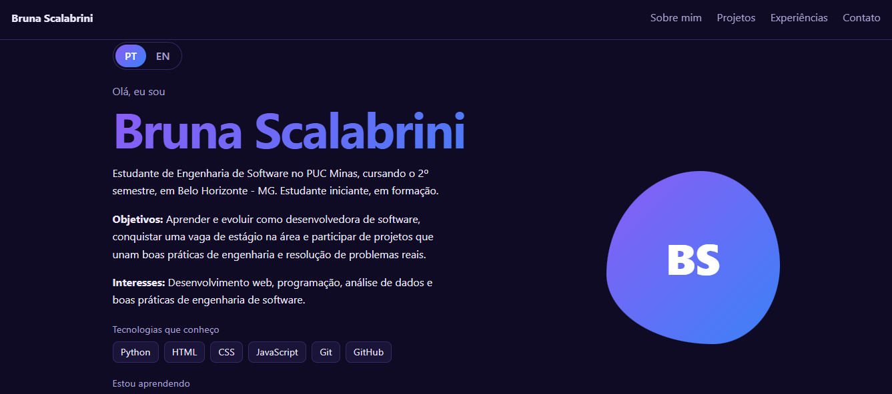
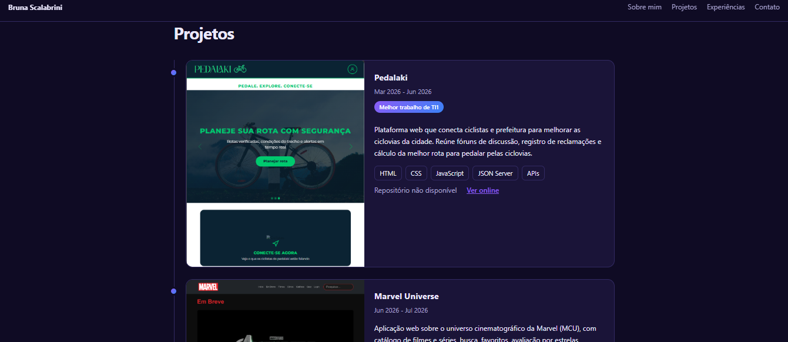
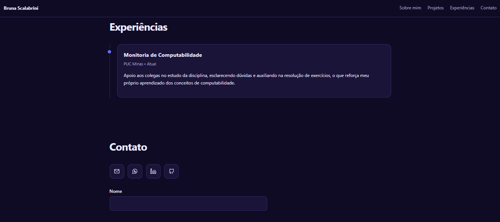
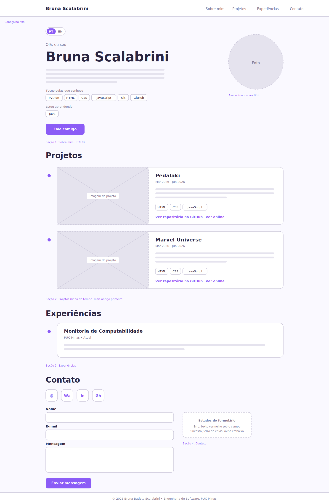
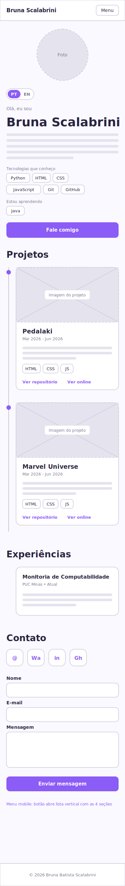

# Portfólio - Bruna Scalabrini

Meu portfólio pessoal, feito para o Laboratório 01 de DIAW (Engenharia de Software, PUC Minas). Ele reúne uma apresentação em português e inglês, uma linha do tempo com meus projetos, minhas experiências e um formulário de contato que manda e-mail de verdade.

## 🚧 Status do Projeto

- [x] Sprint 01: planejamento, wireframes, layout e navegação
- [x] Sprint 02: funcionalidades principais
- [x] Sprint 03: hospedagem e finalização

---

## 📚 Índice

- [Links Úteis](#-links-úteis)
- [Sobre o Projeto](#-sobre-o-projeto)
- [Funcionalidades Principais](#-funcionalidades-principais)
- [Tecnologias Utilizadas](#-tecnologias-utilizadas)
- [Arquitetura](#-arquitetura)
- [Instalação e Execução](#-instalação-e-execução)
- [Deploy](#-deploy)
- [Estrutura de Pastas](#-estrutura-de-pastas)
- [Demonstração](#-demonstração)
- [Testes](#-testes)
- [Documentações utilizadas](#-documentações-utilizadas)
- [Autora](#-autora)
- [Agradecimentos](#-agradecimentos)
- [Licença](#-licença)

---

## 🔗 Links Úteis

- 🌐 **Site publicado:** https://portfolio-phi-wine-aqetk97dkd.vercel.app/
- 📦 **Repositório:** https://github.com/scalabrinibruna/portfolio
- 🎨 **Wireframes no Figma:** https://www.figma.com/design/8vgfzSYJEbT3jdQDp3eGq2/portfolio-wireframe?node-id=0-1&t=ZfSS4YHKJVKHFFIt-1

---

## 📝 Sobre o Projeto

Quis ter um lugar só meu para mostrar quem eu sou como estudante de Engenharia de Software: o que estudo, o que já fiz e como falar comigo. O projeto nasceu como atividade da disciplina de Desenvolvimento e Integração de Aplicações Web, mas a ideia é continuar usando o site depois, inclusive para processos seletivos de estágio.

Todo o conteúdo (meus dados, projetos e experiências) fica em um único arquivo, o `src/data/profile.js`. Quando eu fizer um projeto novo, basta adicionar um item na lista, sem mexer no resto do código.

---

## ✨ Funcionalidades Principais

- 🌐 **Sobre mim** em português e inglês, com um botão PT/EN para trocar
- 🕒 **Projetos** em linha do tempo, do mais antigo para o mais recente, cada um com descrição, tecnologias, imagem, link do repositório e link do site no ar
- 💼 **Experiências** com instituição, atividade, período e descrição
- 📨 **Contato** com ícones (e-mail, WhatsApp, LinkedIn e GitHub) e formulário com validação que envia o e-mail pelo EmailJS
- 📱 Layout responsivo, menu para celular, tema claro/escuro automático e navegação pelo teclado

---

## 🛠 Tecnologias Utilizadas

### 💻 Front-end

- **Biblioteca:** React 18
- **Linguagem:** JavaScript (ES6+)
- **Estilização:** CSS puro
- **Build:** Vite 5

### 📨 Integração

- **Envio de e-mail:** EmailJS (`@emailjs/browser`)

### ⚙️ Ferramentas e hospedagem

- **Versionamento:** Git e GitHub
- **Hospedagem:** Vercel (plano gratuito)
- **Wireframes:** Figma

### 📦 Dependências

| Pacote | Tipo | Para que serve |
| --- | --- | --- |
| `react` e `react-dom` | produção | Interface |
| `@emailjs/browser` | produção | Envio do e-mail do formulário |
| `vite` | desenvolvimento | Servidor local e build |
| `@vitejs/plugin-react` | desenvolvimento | Suporte a React no Vite |

---

## 🏗 Arquitetura

O projeto é uma página estática feita em React, sem back-end próprio. Escolhi assim porque o site só mostra conteúdo e envia e-mail, então um servidor seria só mais coisa para manter.

- O **EmailJS** envia a mensagem direto do navegador, usando apenas chaves públicas. Nenhuma chave secreta fica no código.
- Os **dados ficam separados da interface**: `src/data/profile.js` guarda o conteúdo e `src/App.jsx` só exibe.
- Campos que ainda não tenho (por exemplo, projeto sem imagem ou sem repositório) aparecem com um aviso discreto em vez de ficarem quebrados.
- Cores: roxo e azul, com fonte do sistema para o site carregar rápido.

Limitação: como as chaves do EmailJS ficam no navegador, o controle de spam depende das configurações do próprio EmailJS.

---

## 🔧 Instalação e Execução

### Pré-requisitos

- Node.js 18 ou mais novo
- npm
- Uma conta gratuita no [EmailJS](https://www.emailjs.com/) (só para o formulário funcionar)

### 🔑 Variáveis de Ambiente

Copie o `.env.example` para `.env.local` e preencha:

| Variável | O que é | Onde pegar |
| --- | --- | --- |
| `VITE_EMAILJS_SERVICE_ID` | ID do serviço de e-mail | EmailJS, em Email Services |
| `VITE_EMAILJS_TEMPLATE_ID` | ID do template | EmailJS, em Email Templates |
| `VITE_EMAILJS_PUBLIC_KEY` | Chave pública | EmailJS, em Account > API Keys |

Escreva os valores sem espaço depois do `=`. O `.env.local` não vai para o GitHub.

### ✉️ Configurar o formulário

1. Crie uma conta em https://www.emailjs.com/
2. Em **Email Services**, conecte o Gmail e marque todas as permissões que o Google mostrar (senão dá erro 412)
3. Em **Email Templates**, crie um template com `{{from_name}}`, `{{reply_to}}` e `{{message}}` no conteúdo e `{{reply_to}}` no campo Reply To
4. Copie os três códigos para o `.env.local`

Sem essas variáveis, o formulário valida os campos e avisa que o envio não está configurado, em vez de fingir que enviou.

### 📦 Instalação de dependências

```bash
git clone https://github.com/scalabrinibruna/portfolio.git
cd portfolio
npm install
```

### ⚡ Como executar

```bash
npm run dev
```

Depois é só abrir http://localhost:5173. Se mudar o `.env.local`, reinicie o comando.

Para gerar a versão de produção:

```bash
npm run build
npm run preview
```

### 🎨 Mudando o conteúdo

Edite o `src/data/profile.js`: dados pessoais, contatos, projetos e experiências. As imagens dos projetos ficam em `public/projetos/`.

---

## 🚀 Deploy

O site está na Vercel: https://portfolio-phi-wine-aqetk97dkd.vercel.app/

Como publiquei:

1. Subi o código para o GitHub
2. Na Vercel: **Add New > Project** e importei o repositório
3. Build: `npm run build` | Output: `dist`
4. Cadastrei as 3 variáveis `VITE_EMAILJS_*` em **Settings > Environment Variables**
5. Fiz o deploy (e um **Redeploy** depois de cadastrar as variáveis, porque o Vite só lê elas na hora do build)

A cada `git push` na `main` o site é atualizado sozinho.

---

## 📂 Estrutura de Pastas

```
portfolio/
├── docs/                # prints do site e wireframes
├── public/
│   ├── favicon.svg
│   └── projetos/        # imagens dos projetos
├── src/
│   ├── data/
│   │   └── profile.js   # meus dados, projetos e experiências
│   ├── App.jsx          # cabeçalho, seções e rodapé
│   ├── styles.css       # estilos
│   └── main.jsx         # ponto de entrada
├── .env.example         # modelo das variáveis de ambiente
├── .gitignore
├── index.html
├── package.json
├── vite.config.js
└── README.md
```

---

## 🎥 Demonstração

### 🌐 Aplicação web

| Print 1 | Print 2 | Print 3 |
| --- | --- | --- |
|  |  |  |

### 🎨 Wireframes (Figma)

| Desktop | Mobile |
| --- | --- |
|  |  |

---

## 🧪 Testes

Não fiz testes automatizados. O que conferi foi:

- `npm run build` roda sem erro
- o formulário envia e-mail de verdade, tanto rodando local quanto no site publicado
- o site está no ar na Vercel

Para repetir: rode `npm run dev`, navegue pelas quatro seções, troque PT/EN, diminua a janela para ver o menu do celular e envie uma mensagem pelo formulário.

---

## 🔗 Documentações utilizadas

- [React](https://react.dev/)
- [Vite](https://vitejs.dev/guide/)
- [EmailJS](https://www.emailjs.com/docs/)
- [Vercel](https://vercel.com/docs)

---

## 👥 Autora

| 👤 Nome | GitHub | LinkedIn | E-mail |
| --- | --- | --- | --- |
| Bruna Batista Scalabrini | [scalabrinibruna](https://github.com/scalabrinibruna) | [bruna-scalabrini](https://www.linkedin.com/in/bruna-scalabrini-7b58913a0/) | [scalabrinibruna0@gmail.com](mailto:scalabrinibruna0@gmail.com) |

---


## Agradecimentos

- **Engenharia de Software PUC Minas**, pela estrutura e apoio
- **Prof. Dr. João Paulo Aramuni**, pela proposta do laboratório e pelo template de README

---

## 📄 Licença

Projeto feito para fins acadêmicos.
